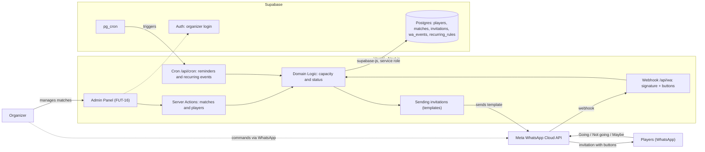
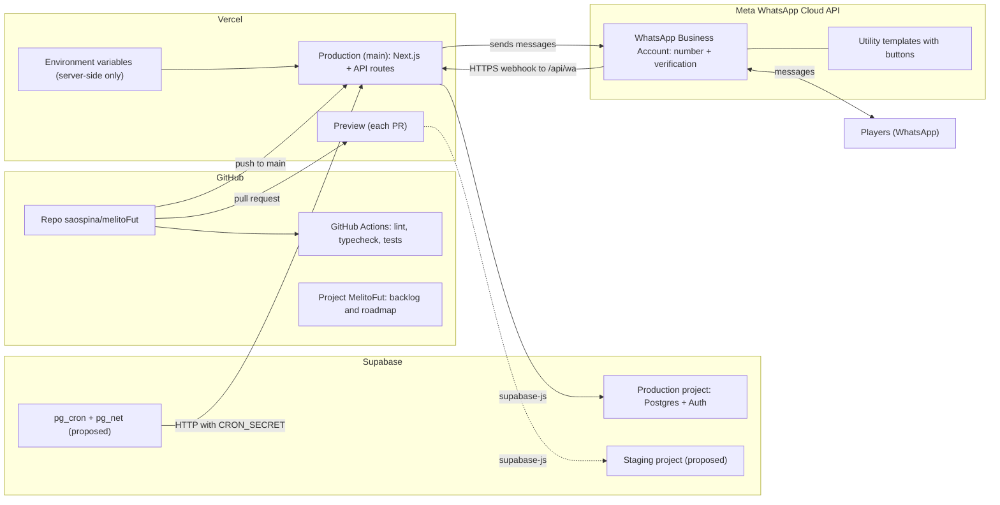
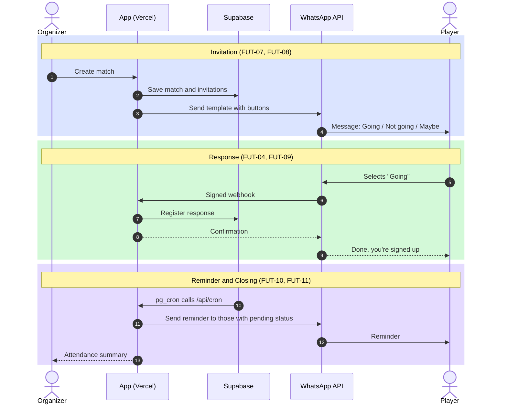
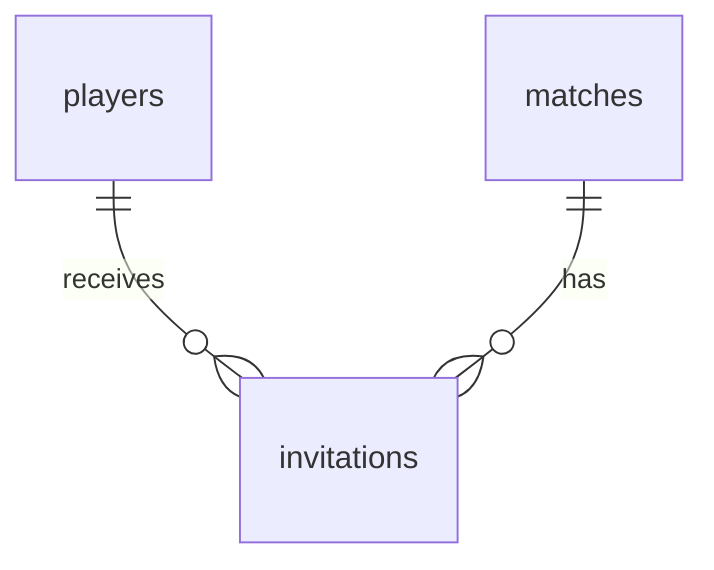

# MelitoFut: Architecture and Infrastructure

Everything resides in two components: **Next.js on Vercel** (webhooks, messaging, cron jobs, and the admin panel) and **Supabase** (data, authentication, and cron jobs). Meta serves solely as a message transport layer.

> The diagrams are written in Mermaid format so that Claude Code can read them as text and GitHub can render them.
> Items marked as **proposed** are not yet confirmed in the backlog; please confirm or discard them within the corresponding ticket specification.

## 1. Logical Architecture

Notes:

- All data access from Vercel uses `supabase-js` with the service role, exclusively on the server side. - The Supabase cron job triggers reminders and recurring matches. The organizer can also use commands within the bot's chat (FUT-15).

## 2. Infrastructure and Deployment

Environment variables (values ​​stored only in Vercel, never in the repo):

| Variable | Purpose |
|---|---|
| `WA_ACCESS_TOKEN` | Permanent system user access token (Meta). |
| `WA_APP_SECRET` | Used to validate the `X-Hub-Signature-256` header from the webhook. |
| `WA_VERIFY_TOKEN` | Responds to the `hub.verify_token` verification (GET request). |
| `SUPABASE_SERVICE_ROLE_KEY` | Server-side access to Postgres. |
| `CRON_SECRET` | Protects the `/api/cron` endpoint. |

Additionally, `PHONE_NUMBER_ID` and `WABA_ID` are required (obtained from FUT-01).

## 3. Match Lifecycle

Variations not shown in the diagram (covered by their respective tickets):

- **Not going / Maybe**: Follows the same flow but with a different invitation status (FUT-09). - **Full capacity**: the player is placed on a `waitlist` and receives their position (FUT-12). If someone drops out, the first person on the waitlist is moved to `yes` (FUT-13).
- **Free-text response**: the player receives a reminder to use the buttons (FUT-09).
- **Closed or cancelled match**: the response triggers a notification, but no other status changes occur (FUT-09, FUT-17).
- **Failed delivery**: the invitation is flagged, but this does not stop the processing of other invitations (FUT-08); monitoring is handled via FUT-20.

## 4. Data model

`wa_events` is linked to `invitations` via `wa_message_id` (no foreign key). `recurring_rules` generates matches (FUT-14, P1).

| Table | Key fields | Notes |
|---|---|---|
| `players` | id, name, phone_e164, role (player) | |/arquero), active, opted_in_at | unique `phone_e164` |
| `matches` | id, starts_at, venue, capacity, status (draft/open/closed/cancelled), rsvp_deadline | time in UTC, displayed in America/Bogota |
| `invitations` | id, match_id, player_id, wa_message_id, status (pending/yes/no/maybe/waitlist), responded_at, reminders_sent | unique `(match_id, player_id)` |
| `wa_events` | id, wa_message_id, type, payload jsonb, received_at, processed_at | raw webhook log; basis for idempotency |
| `recurring_rules` | id, weekday, time, venue, capacity, send_offset_hours, active | P1 |

The `payload` for each button contains the `invitation_id` and the selected option.

## 5. Decisions Made

- **Official WhatsApp Cloud API** with quick-reply buttons, rather than a group chat or an unofficial library.
- **Utility templates**: allow messaging outside the 24-hour window. Expected cost: a few cents (USD) per month for Colombian phone numbers.
- **Single organizer** and a dedicated number for the bot. Starting with Meta’s test number (piloting with 3–5 friends; FUT-21 will open to everyone).
- **Next.js + Supabase** instead of a custom backend: fewer components to manage.

## 6. Proposed (Pending Confirmation)

- **Staging Supabase project** for PR previews.
- **`pg_cron` + `pg_net`** as the specific mechanism to trigger `/api/cron` (the backlog currently just specifies "Supabase cron").
- Exact naming and scope for the API routes (`/api/wa`, `/api/cron`). ## 7. Risks

| Risk | Impact | Mitigation |
|---|---|---|
| Meta reclassifies the template as "Marketing" | Higher costs and more friction | Use transactional text (no promotions); have a backup variant ready (FUT-05) |
| Notifications to the organizer fall outside the 24-hour window | Free-text messages fail to deliver | Send a message to the bot once a day, or use a second "utility" template for notifications |
| Meta price changes (quarterly review) | Unexpected costs | Cost summary included in FUT-20 |
| Friends do not save or recognize the bot's phone number | Messages get ignored | Use a clear, visible display name and send a personal private message introducing the bot |
| Test messages only reach a few registered recipients | The MVP does not cover everyone | Run a pilot with 3–5 friends; FUT-21 will be open to everyone |

## 8. Open Decisions

- [ ] Dedicated phone number: New SIM card or virtual number?
- [ ] Should notifications for every individual response be enabled by default, or only the summary?
- [ ] How many hours before the match should the response window close?